<h1 align="center">
  
   
  CPC Online Judge
</h1>

A DMOJ fork for programming practice and ICPC-style contests.

  
  <a href="docs/setup-guide.md">Installation</a> ·
  <a href="docs/fork-overview.md">Features</a> ·
  <a href="#django-52">Django 5.2</a> ·
  <a href="#security">Security</a> ·
  <a href="docs/duels.md">Duels</a> ·
  <a href="docs/mass-email.md">Emails to users</a> ·
  <a href="docs/contest-tools.md">Contest guide</a> ·
  <a href="MODIFICATIONS.md">Changelog</a>

Run individual or team contests with frozen scoreboards, an interactive reveal
ceremony, balloon delivery tools and a Spanish interface, and 1v1 duels and
knockout tournaments on a projector. This fork is maintained
by **CPC-UAEH** and builds on [DMOJ](https://github.com/DMOJ/online-judge), with
additional contest, administration and deployment features.

**Get started:** follow the [installation guide](docs/setup-guide.md) to configure
your own instance. DMOJ provides problem statements in Markdown and LaTeX, live
submission results, multiple contest formats, virtual participation and support
for many programming languages through the
[judge server](https://github.com/DMOJ/judge-server).

## Django 5.2

This fork includes the upgrade to **Django 5.2.17**, pinned in
[`requirements.txt`](requirements.txt), with compatibility changes for timezone
handling, storage configuration, static-file compression and contest
administration. The upgrade also updates the tested django-mptt and
django-compressor dependencies.

The [upgrade guide](docs/django52/README.md) covers the code changes, the
settings and how to upgrade an existing installation. The
[setup guide](docs/setup-guide.md) explains how to configure a new instance.

## Security

### Application protections

- **Protected owner accounts:** owner-only deletion and sensitive account
  administration, including protection from changes by other superusers.
- **Restricted impersonation:** superuser-only access, protected superuser
  accounts and audit logging.
- **Private custom tests:** signed ownership checks, read-only result polling
  and exclusion from public histories, APIs and statistics.
- **Abuse controls:** configurable admission and rate checks for custom tests,
  plus rate and length limits for contestant clarification requests.
- **Controlled deletion:** explicit confirmations list the records affected by
  permanent team or contest deletion; submission records are preserved.
- **Scoped jury tools:** jury members can only file or move clarifications into
  contests they can edit, and answers change visibility together with their
  announcements.
- **Upload check:** Nginx asks the application whether a caller may upload
  problem data before accepting a large request body.
- **Live updates that stay up:** the event daemon answers malformed messages
  with an error instead of ending the process.
- **Email limits:** two password reset emails per address and one email change
  per account in 24 hours, a daily cap for the whole site with a reserve for
  existing accounts, and no account is created if its activation email cannot be
  sent.

### Deployment controls

The [deployment examples](deploy/examples/README.md) and
[security guides](docs/security/README.md) provide configuration for:

- separate unprivileged service accounts, systemd isolation and read-only code;
- authenticated Redis and private service listeners;
- secure session and CSRF cookies, edge HSTS, a structural Content Security
  Policy and referrer policy;
- the visitor's real address behind a tunnel, so per-IP limits count each visitor;
- request-size limits, a permission check before large uploads, on-disk request
  buffering, disabled directory listings and a private event-publishing endpoint;
- protected configuration and backups, and scheduled cleanup of finished custom
  tests.

Application protections are included in the source; deployment controls must be
configured for each installation. The [security guides](docs/security/README.md)
explain each control and its known limitations.

## Contests

*The screenshots below show this fork's interface with fictional demo accounts,
teams, contests and results. They do not represent a real competition.*

### Frozen scoreboards

Configure a freeze window and keep results hidden across the scoreboard,
participation pages, submissions, statistics, problem counters, API and live
updates. Contestants still see their own submissions, and their row marks the
results the frozen board is not showing. Organizers explicitly release the final
results.

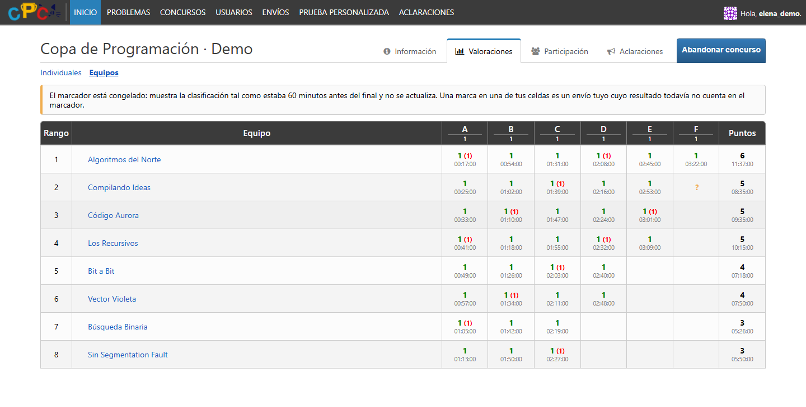

### Reveal ceremony

The reveal ceremony works with **both individual contestants and teams**.
Reveal results in order with adjustable playback speed, medal ranges,
tie handling and first-to-solve awards. Award cards show the individual
contestant or the team and its registered members. In mixed contests, select
the individual or team division to present its standings.

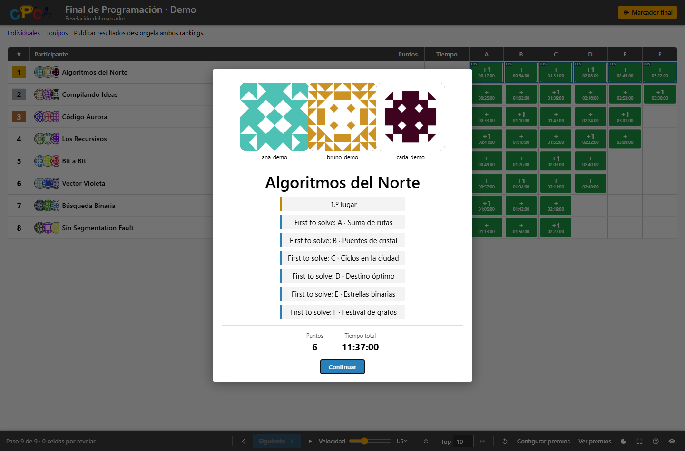

### Balloon delivery

Track pending and delivered balloons, assign problem colors and participant
locations, and undo delivery mistakes. Dedicated staff permissions control access
to the desk; accepted submissions during the freeze remain hidden.

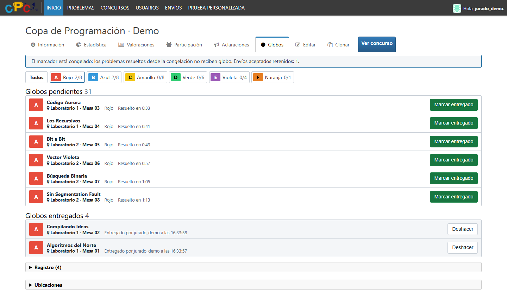

### Announcements and clarifications

Publish announcements for the whole site or one contest. Contestants can ask
about a problem or the contest rules; the jury can answer privately or share an
answer with everyone.

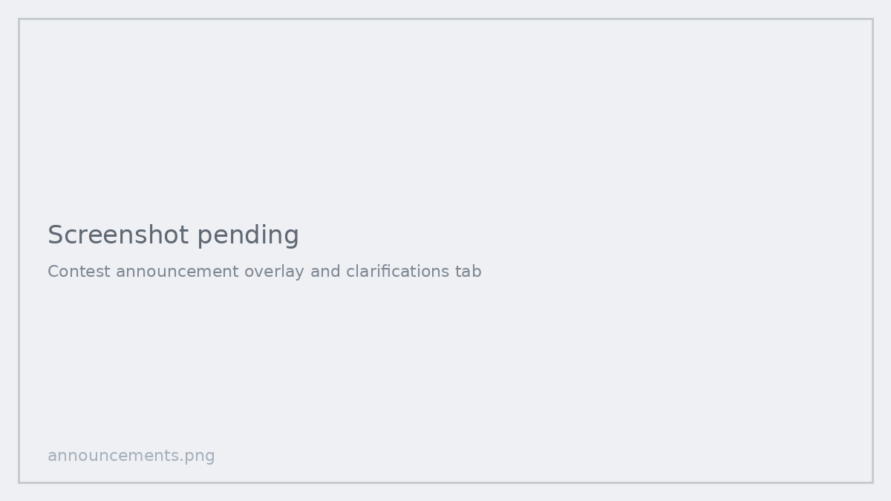

### Every statement in one PDF

Participants download all the statements of a contest in one PDF once it starts,
to keep reading if the connection drops; organizers can prepare it beforehand.
Problem PDFs no longer get stuck as empty files after a failed render. Both need
[pdfoid](docs/pdf.md).

## Duels

First-to-solve battles between two players, alone or as best-of-N series, and
knockout tournaments with a bracket that builds itself. Organizers call the
players, pick the problems by hand or from a problem bank, and start each game
from a panel. Players stay on the duel page and submit from it until the battle is
decided; a projector shows both players' code live, the scoreboard, the
statements and the bracket. Organizers manage their own battles and the ones they
are added to as co-organizers; one permission gives every battle.

See the [duels guide](docs/duels.md) for the setup, the rules of a game and the
known limitations.

## Teams

### Teams and invitations

Create a team, invite members and manage the roster from **My teams**. Members
submit from their own accounts while sharing the team's contest score and clock.

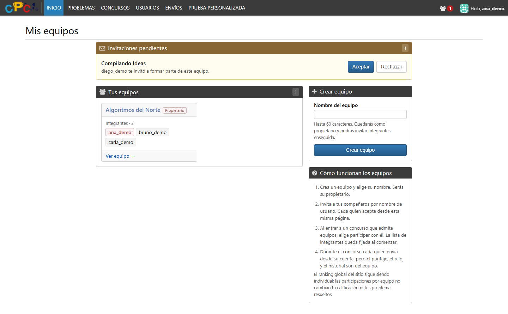

### Contest registration

Choose individual or team participation and select the members who will compete.
One access code registers the selected roster, subject to the contest's team
size and individual eligibility rules.

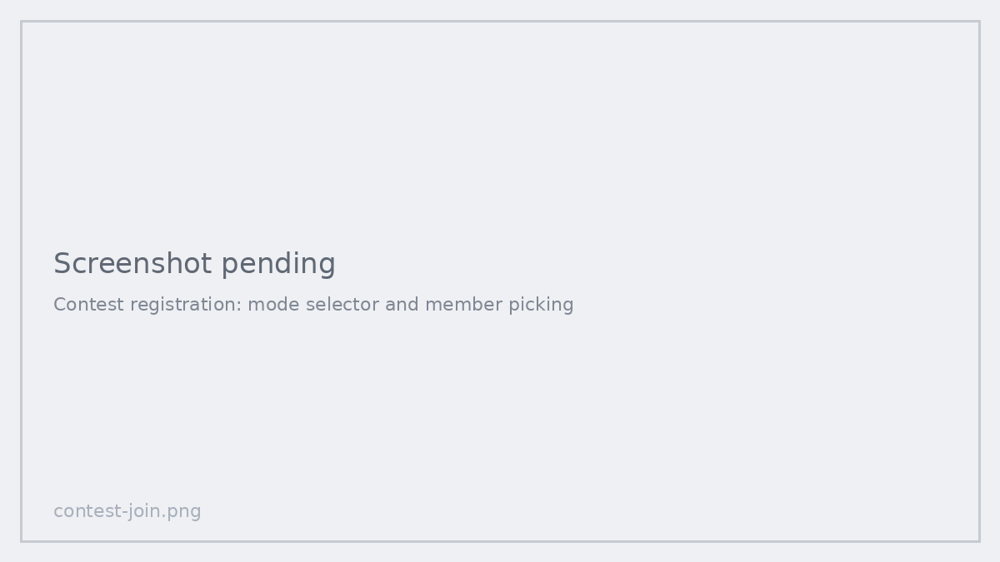

### Separate rankings

Run individual, team or mixed contests. Mixed contests have separate ranking
tabs, and team results stay separate from individual site ratings. Rankings
refresh automatically while the browser tab is visible.

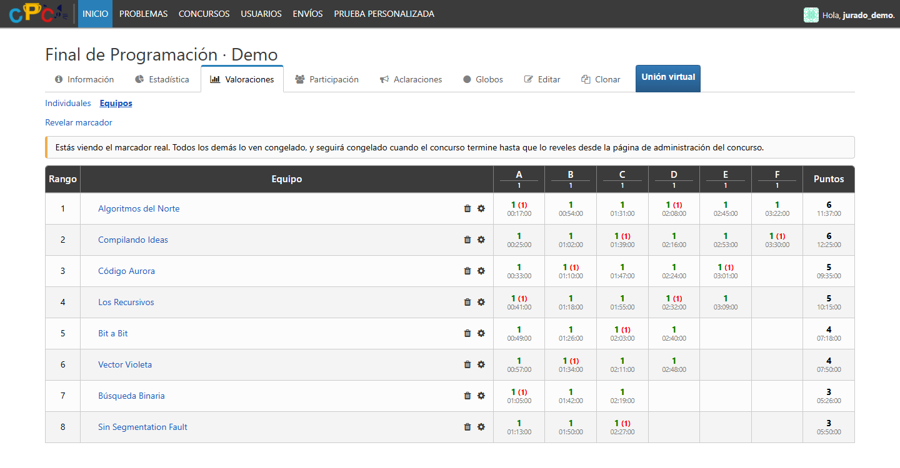

## Interface

### Light and dark themes

Every account can choose a light or dark theme, or follow the system preference.
The fork's screens and navigation include Spanish and English translations.

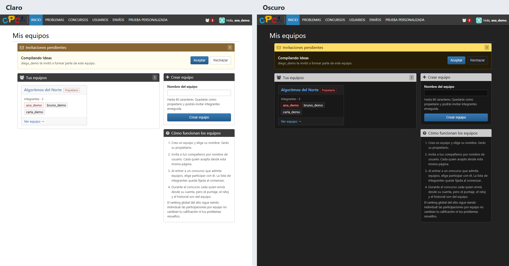

### Phones

Pages load on phones at a stable 480 px layout scaled to fit, without the
zooming in and out that upstream shows at some screen widths. Wide editor tables,
such as the test case table, scroll inside their own box.

### Account emails

Activation, password reset and email change messages share one design that reads
well in Gmail, Outlook and phone apps: the site logo, a button with a plain link
below it, and a contact line. Every email ends with a line saying the club is
independent and not an official service of its university.

### Custom tests

Try code with your own input in a spacious editor, with translated status
messages and output up to 64 KB by default. Custom tests remain separate from
public submission histories and statistics.

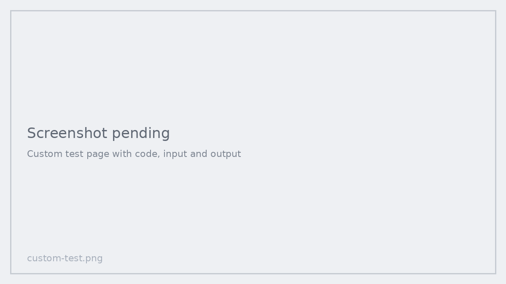

### Test cases from ZIP archives

Populate test cases from paired input and output files. Automatic pairing
supports extensions or folders, natural ordering, batch detection and integer
point distribution, with feedback for unpaired files.

### Interactive problems

Upload an interactor next to the test data and the problem becomes interactive.
The data page writes the judge configuration on every save, recognizes testlib
interactors and supplies `testlib.h`. It links to a guide for problem setters with
a complete example that can be downloaded. Uploading a new data archive over an
existing one also works now; upstream lost both files.

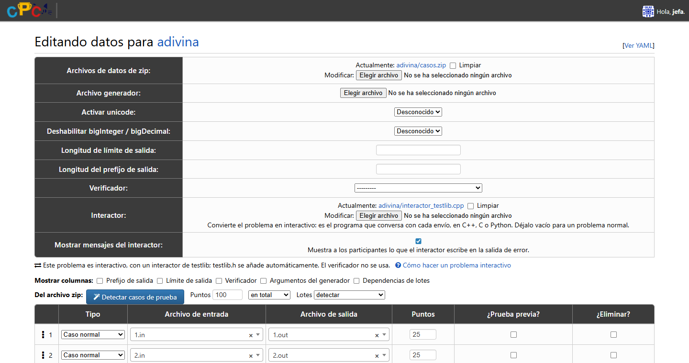

### Sample tables and math

Write the samples of a statement as OmegaUp does, with `||input`, `||output`, an
optional `||description` and `||end`, and they show as a compact table with a copy
icon on each input. Inline formulas also accept `$...$`, with rules that keep
prices as text. Statements written the usual way render exactly as before.

## Administration

Manage teams, invitations, memberships and contest participation from the admin,
with search by team or member.

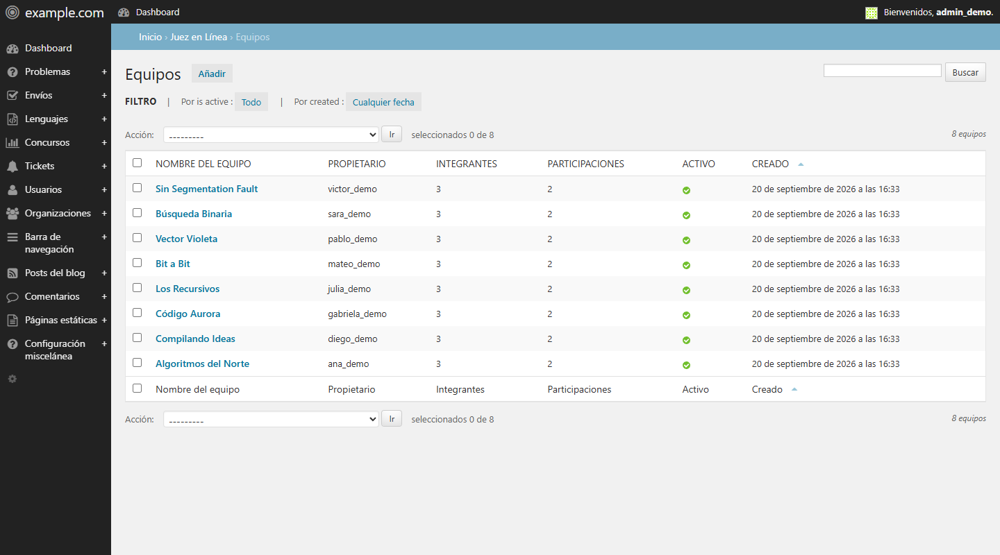

Accounts configured in `CPC_SERVER_OWNERS` control deletion and sensitive account
administration. Other superusers cannot edit those accounts or grant the protected
privileges. Permanent team and contest deletion requires a confirmation that
lists the affected records; submission records are preserved.

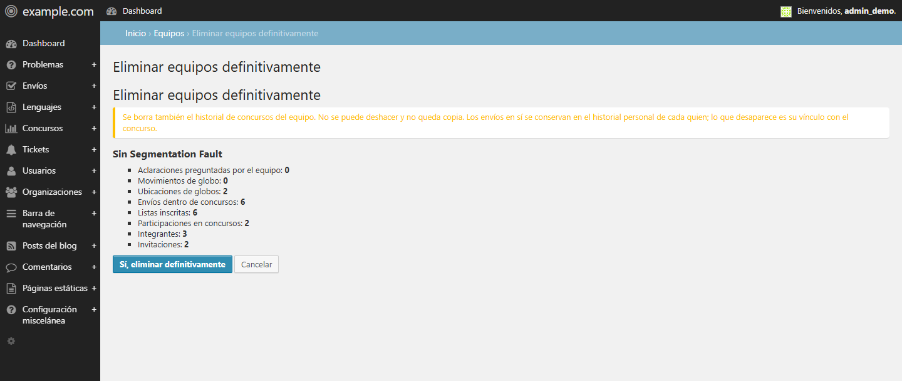

Contest authors can remove a problem from a contest they edit. The problem and
its submissions stay; only their link to the contest goes. This is the only
exception to the owner-only deletion lock. The two-list permission selector shows
full permission names at any screen width. Pages that can only be viewed offer a
Back button in the bottom bar.

### Emails to users

Write an announcement in the admin and send it to many accounts through Resend:
to everyone with a confirmed email, to those matching filters (contests,
organizations, groups, recent activity, sign-up dates, solved problems, rating) or
to people chosen by name. Preview it as a desktop and a phone would show it, send
yourself a test, confirm by typing the number of recipients, send now or schedule
it, and read the delivery figures afterwards. Unsubscribes are honoured; writers
manage their own emails, and one permission gives all of them.

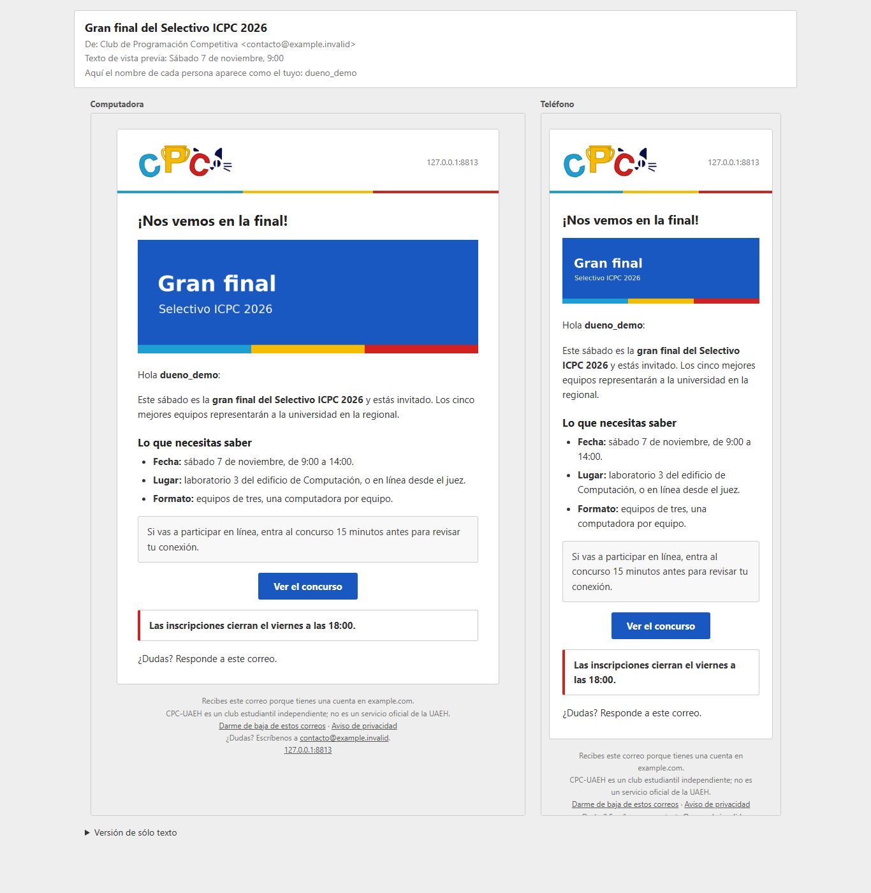

See [Emails to users](docs/mass-email.md) for the setup with Resend.

## Installation and documentation

Start with a working [DMOJ installation](https://docs.dmoj.ca/#/site/installation),
then follow [Setting up this fork](docs/setup-guide.md) for settings, migrations,
translations, static assets, service configuration, scheduled cleanup and your
own branding.

| Guide | Contents |
| --- | --- |
| [Setup guide](docs/setup-guide.md) | Installation, configuration and verification |
| [Fork overview](docs/fork-overview.md) | Features and changes relative to upstream |
| [Django 5.2 upgrade](docs/django52/README.md) | Compatibility changes, tested dependencies and upgrade guidance |
| [Contest tools](docs/contest-tools.md) | Freeze, reveal, balloons, announcements and clarifications |
| [Interactive problems](docs/interactive-problems.md) | Interactors from the data page, judge requirements and verdicts |
| [Duels](docs/duels.md) | Battles, tournaments, projectors, who organizes what, settings and limitations |
| [Emails to users](docs/mass-email.md) | Announcements to many accounts through Resend: audiences, sending, unsubscribes, permissions |
| [Sample tables and math](docs/statements.md) | The `\|\|input` table and `$...$` in statements |
| [PDFs](docs/pdf.md) | Problem and contest PDFs with pdfoid |
| [Deployment examples](deploy/examples/README.md) | Example service units, Nginx settings and maintenance tasks |
| [Security guides](docs/security/README.md) | How to configure each control, and known limitations |
| [Screenshot gallery](docs/screenshots/README.md) | Full-size demonstration images |

## Upstream and license

Based on DMOJ commit `97f3722ef3f7ca9731727c220622bdd1eab7d4b3`.
Distributed under the [GNU Affero General Public License v3](LICENSE).
See [MODIFICATIONS.md](MODIFICATIONS.md) for the fork's changes and attribution.

Production credentials, user data, problem packages, uploaded media, logs and
generated static files are excluded from this repository.

Upstream resources: [DMOJ](https://github.com/DMOJ/online-judge) ·
[Documentation](https://docs.dmoj.ca/) ·
[Judge server](https://github.com/DMOJ/judge-server) ·
[Community](https://dmoj.ca/about/discord/).
