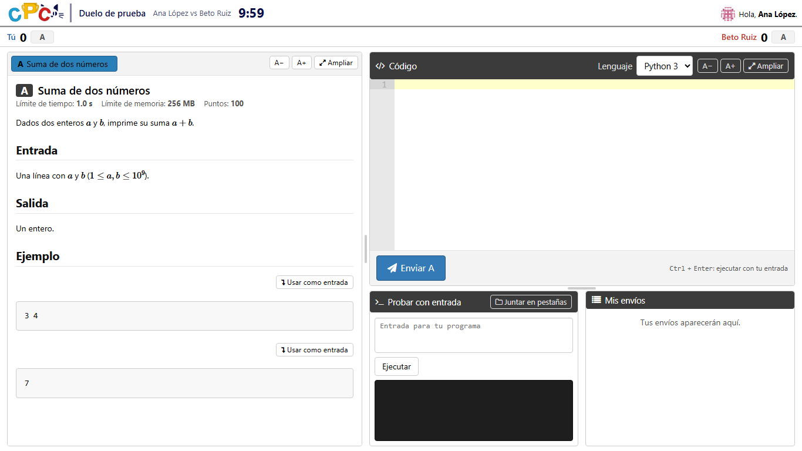
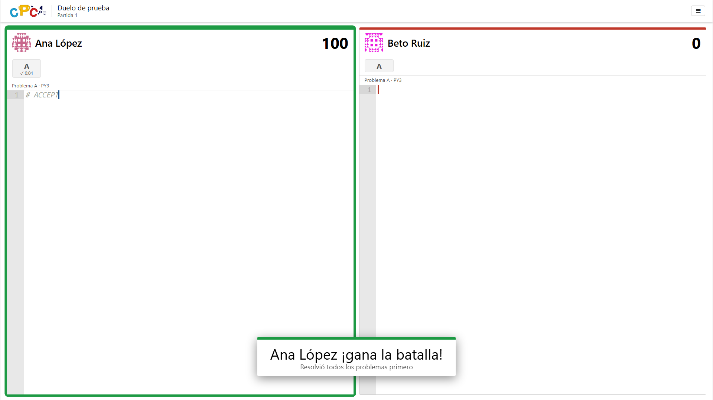

# Duels and tournaments

Duels are first-to-solve battles between two players. A battle is one game or a
best-of-N series, and a tournament arranges battles in a knockout bracket. The
site shows them at `/duelos/`; in the code the feature is called *arena*
(`judge/arena`, the `Arena*` models and the `arena_*` URL names). Requests to the
earlier address `/arena/…` are forwarded to the same place under `/duelos/` with a
307, so saved projector links and open player pages keep working.

## Setting it up

1. **Migrate.** Migration `0157_arena` only creates the `judge_arena*` tables.
2. **Use a shared cache.** Live code, drafts, the player lock and the request
   limits live in the Django cache. With several web workers it must be shared
   (Redis, as in the [settings example](../dmoj/local_settings.example.py)); a
   per-process cache makes players and screens see different things.
3. **Give organizers the permission.** Everything is behind one permission,
   `judge | arena match | Organize arena battles` (`judge.manage_arena`). Create a
   group with it, plus `see_private_problem` if battles should use problems that
   are not public, and add the organizers. Superusers have it already.
4. **Add the navigation entry.** In the admin, under *Navigation bar*, add an
   entry with key `arena`, label `Duelos`, path `/duelos/` and regex `^/duelos`.
   The label is translated through the `dmoj-user` catalog; both the Spanish and
   the English catalog have an entry for `Duelos`. A label with no entry in the
   reader's language falls back to English.
5. **Recompile translations and, with offline compression, regenerate the
   manifest**, as after any template change. See the
   [setup guide](setup-guide.md#4-translations).

The judges need the problems used in battles, as for any contest. The admin gets
a *Battles* section (`dmoj/settings.py`, `WPADMIN`): if your private settings
redefine `WPADMIN`, copy that entry into yours.

## Running battles

Organizers work from the panel at `/duelos/manage/`, linked from the *Battles*
section of the admin. Every page of the panel links to a guide for organizers at
`/duelos/manage/guide/`, written in Spanish.

- **Quick battle.** Pick two players and the problems of each game (up to five per
  game), or leave the problems for later. *Call* the battle: both players are sent
  to the duel page and see who they play. *Start* begins a countdown, and then the
  statements appear. A battle can also be a best-of-1, 3, 5, 7 or 9 series.
- **Tournament.** Up to 64 participants, seeded by hand, at random or by rating,
  with an optional third-place match. The bracket is built by itself when the
  tournament is created and rebuilt when participants or the third-place option
  change; problems already chosen stay where they were. Each round can have its
  own series length and rules.
- **Problems.** Choose them by hand for each battle and each game, even before the
  players are known, or let a *problem bank* deal them: on call, on start and after
  each game, never repeating a problem inside the tournament, optionally limited
  to a range of difficulties per round. What was chosen by hand is never replaced.
  If the bank runs out, the game is left for the organizer to fill in.
- **Several organizers** can work at once. Every action carries a version; an
  action based on an old state is refused with a conflict instead of overwriting
  someone else's.

### Rules of a game

Rules are set per tournament, per round and per battle, each level overriding the
previous one:

| Rule | Default | Range |
| --- | --- | --- |
| Duration | 15 minutes | 1 to 300 |
| Countdown | 10 seconds | 3 to 60 |
| Partial points | off: all or nothing | |
| Penalty per failed attempt | 0 minutes | 0 to 60 |
| Maximum attempts per problem | unlimited | 0 to 50 |
| Languages | every language the problem allows | |
| Block pasting | on | |
| Show rival progress | on (points and attempts, never code) | |
| Code on the screens | on | |

The player with more points wins; on equal points, whoever got there first, with
the penalty added for each failed attempt before their best submission. Compile
and internal errors cost nothing. A game ends by itself as soon as nobody can
change the result, and waits for a pending submission only while it could. A tie
at the end is decided by the organizer or by a tiebreak game.

### Club laptops

For quick battles on shared machines, sign in with an account you trust and type
the name to show for each player. When the battle ends, drafts and review data
are cleared for the next person. Players with their own account can stay to
review the game afterwards: the editor and custom input keep working and each
submission shows its code.

## What players get

- While their battle lasts, players are kept on the duel page: other pages send
  them back, and the normal submission page refuses submissions. The lock ends
  when the battle is decided or cancelled, and also after
  `CPC_ARENA_LOCK_IDLE_MINUTES` (60) without activity, so a battle left open by
  mistake does not hold anyone. It applies to staff too.
- The page keeps the site's navigation bar; during a battle the bar shows the
  battle, the players and the clock instead of the tabs.
- The statement, an editor, custom input with "Use as input" on every sample, and
  their submissions. Text size, enlarged panes, dividers and tabbed or side-by-side
  panels are remembered in the browser.
- Pasting is limited to text the player already has in this game's code or copied
  from the editor; pasting from elsewhere and dragging are blocked and flagged.
- The result is explained from each side, with the rival's name and, for a series,
  every game.

## Projectors

Projectors open a secret link, made from the panel, with no account. A screen has
six views: combined, scoreboard, the live code of each player, the statements and
the bracket. A new quick battle goes to a free screen by itself, and the bracket
view follows the battle that starts. Regenerating a screen's token closes every
tab that uses it.

Live code is sent by the editor about three times a second, kept in the cache and
polled by the screens. It does not go through the event daemon.

## Settings

All optional, in `local_settings.py`. Zero turns a limit off; an invalid value uses
the default.

| Setting | Default | What it limits |
| --- | --- | --- |
| `CPC_ARENA_LOCK_IDLE_MINUTES` | 60 | Minutes without activity before the lock lets players go (5 to 1440) |
| `CPC_ARENA_STATE_PER_SECOND` | 6 | State polls per player |
| `CPC_ARENA_CODE_PER_SECOND` | 4 | Live code updates per player; the editor sends at most 3 |
| `CPC_ARENA_SUBMISSIONS_PER_10_SECONDS` | 4 | Submissions per player |
| `CPC_ARENA_SCREEN_PER_SECOND` | 30 | Requests per projector screen |

Request bodies are capped at 200 KB and code at 64 KB.

## How it works

- Each game is backed by a hidden, unrated contest created when the game starts,
  with key `arena<n>…` and a hidden scoreboard. Judging goes through the normal
  contest queue, the bridge and `update_contest`. The contest does not set the
  players' current contest.
- These contests are left out of `/contests/` and out of the contest and
  participation lists of the admin. The *Battles* section has a *Duel contests*
  entry that lists them (`?duelos=si`). Deleting a game deletes its contest; a game
  in progress cannot be deleted.
- The engine is lazy: each state poll decides start, end and winner, and only locks
  the match row when something changes. There is no periodic task.
- Every organizer action is recorded in `ArenaAction`.

## Known limitations

- Keeping players on the editor is only partly possible. The site blocks
  submitting elsewhere, the rest of the site, pasting and dragging, and flags
  suspicious signals, but nothing stops someone from typing what they see on
  another device.
- With public problems, battle submissions show up in the submission lists and the
  API like those of any hidden contest.
- A screen link gives read-only access to whatever that screen shows, live code
  included. Keep it private and regenerate it after an event.
- An account that played a battle cannot be deleted; deactivate it instead.
- Verdicts reach the page by polling, within about a second.

Tests: [`tests/duels`](../tests/duels/README.md).
