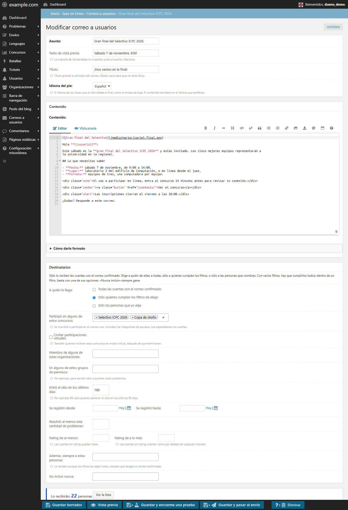
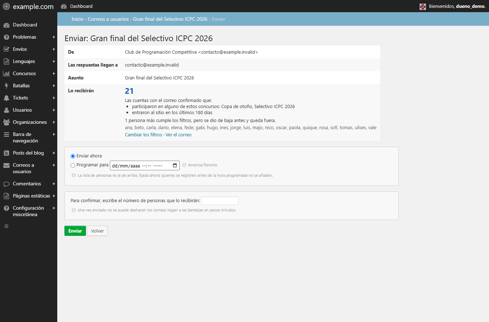
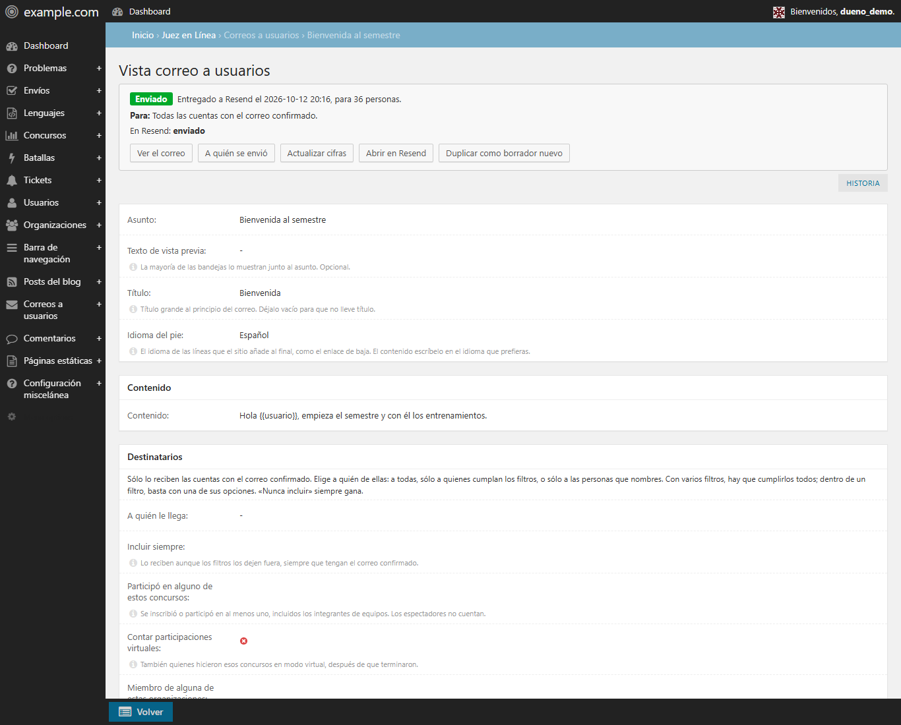

# Emails to users

Write one email in the admin and send it to many accounts at once: contest
announcements, training sessions, changes to the site. These emails go through
[Resend](https://resend.com) Broadcasts, never through the site's SMTP:
transactional providers forbid bulk mail, and it would use up
`DMOJ_EMAIL_DAILY_LIMIT`, which protects account emails (see [Email](security/email.md)).



## Setting it up

1. Create a Resend account and verify your sending domain there (SPF and DKIM
   records in your DNS).
2. Create an API key with **full access**. A "sending only" key cannot create
   contacts or segments, and nothing could be sent.
3. In `dmoj/local_settings.py`:

   ```python
   DMOJ_RESEND_API_KEY = 're_...'
   # Optional: sender and reply-to. By default DEFAULT_FROM_EMAIL and SITE_ADMIN_EMAIL.
   DMOJ_MASS_EMAIL_FROM = 'Your Club <news@example.org>'
   DMOJ_MASS_EMAIL_REPLY_TO = 'contact@example.org'
   # Optional: base of links and images. By default https:// and the domain of the current Site.
   DMOJ_MASS_EMAIL_SITE_URL = 'https://judge.example.org'
   ```

   The sender's domain must be the one verified in Resend.
4. Apply migrations `0158` and `0159`, and restart the web service **and Celery**:
   a Celery task hands each email to Resend.
5. Give the permission to whoever writes emails (see [Permissions](#permissions)).
   The section appears in the admin menu as Emails to users, with the list of
   unsubscribed people under it.

Without a key the section is there but cannot send, and "Save and send me a
test" stays disabled.

## Writing an email

- **Subject, preview text and title.** The preview text is what most inboxes
  show next to the subject. Leave the title empty for an email without one.
- **Content** in Markdown, with HTML allowed: it is cleaned with the `email`
  Markdown style, which drops what email programs cannot show (style sheets,
  audio, video) and math, which needs MathJax. Images come from the editor's
  uploader; links and images become absolute addresses. "How to give it format",
  under the editor, lists the boxes and buttons that look good in email programs.
- `{{usuario}}` (or `{{username}}`) becomes each person's username.
- **Footer language:** the language of the lines the site adds at the end
  (unsubscribe link, contact). Write the content in whatever language you want.
- **Preview** shows the email as a desktop and a phone would, plus the plain text
  version. **Save and send me a test** sends one copy to your own address, marked
  `[Test]`.


## Who receives it

Only accounts with a confirmed email can receive these emails. Choose one of:

1. **Every account with a confirmed email.**
2. **Only those matching the filters.** Each filter narrows the list; within a
   filter with several choices one is enough:
   - took part in some contests (team members included; spectators do not count),
     optionally counting virtual participations;
   - member of some organizations, or of some permission groups;
   - visited the site in the last N days;
   - signed up on or after, and on or before, a date;
   - solved at least N problems;
   - rating at least / at most (accounts without a rating are left out of the
     minimum and count as below any maximum).

   "Also always these people" adds people the filters leave out.
3. **Only the people I choose,** by name.

"Never include" applies to the three and always wins. The form keeps a live
count with a sample of names, and describes the audience in words.

## Sending

The send page shows the sender, the reply-to address, the subject and the
audience, and asks you to **type the number of recipients** to confirm. Send now
or schedule it from 5 minutes to 30 days ahead. The list is fixed when you
confirm: people who sign up before a scheduled time are not added. People who
unsubscribed earlier are left out and counted apart.



Once confirmed, a task page follows the hand-over to Resend; you can leave it,
the task keeps running. If it fails after creating the list but before Resend
accepted the email, **Retry** continues without sending twice.

## After sending

A sent email can no longer be edited. Its page shows the status, delivery
figures read from Resend (delivered, bounced, marked as spam, unsubscribed,
suppressed), who it was sent to, a link to open it in Resend, and **Duplicate as
a new draft**. The bar at the bottom of a page you can only view offers **Back**.



## Unsubscribes

Resend adds an unsubscribe link to every email and honours it. People who used
it no longer receive emails to users, but still get the emails of their account
(activation, password reset, email change). Unsubscribed people, under Emails to
users in the admin, lists them with their username; addresses are masked for
anyone who is not a superuser. Subscribe someone again only if they ask you to.

## Permissions

| Permission | Gives |
| --- | --- |
| `judge.send_mass_email`, "Write and send own emails to users" | The section, with only the emails the person wrote or duplicated |
| `judge.edit_all_mass_email`, "Edit and send all emails to users" | All emails, and subscribing someone again; works on its own |

Superusers have both. Someone else's email answers 404.

## The footer

Every email the site sends, these and the account emails, ends with a line saying
that the club is independent and not an official service of its university, and
emails to users link the privacy notice at `/privacidad/`, a flat page you create
in the admin. That line names this club. In a fork, change it in
`templates/registration/email_base.html`, `templates/mass_email/email.html`,
the four `templates/registration/*_email.txt` and `judge/mass_email.py`, and its
translations, or remove it.

## Settings

| Setting | Default | Meaning |
| --- | --- | --- |
| `DMOJ_RESEND_API_KEY` | `None` | Resend API key with full access; without it nothing can be sent |
| `DMOJ_RESEND_REQUESTS_PER_SECOND` | `4` | Requests per second to Resend; its limit is 10 per account, shared with anything else using it |
| `DMOJ_MASS_EMAIL_FROM` | `None` | Sender; `None` means `DEFAULT_FROM_EMAIL` |
| `DMOJ_MASS_EMAIL_REPLY_TO` | `None` | Reply-to; `None` means `SITE_ADMIN_EMAIL` |
| `DMOJ_MASS_EMAIL_SITE_URL` | `None` | Base of links and images; `None` means `https://` and the current Site's domain |

## How it works

- Each email gets a Resend segment with its recipients as contacts (new contacts
  start subscribed; existing ones keep their choice), and then a broadcast to that
  segment. Resend replaces the name and the unsubscribe link for each contact.
- The client in `judge/utils/resend.py` stays below the request limit, waits and
  retries on 429 and on 5xx, and never repeats a request that could send twice.
- Resend's free plan holds three segments and 1,000 contacts. Before creating a
  segment, the task deletes the segments of emails that are done; scheduled emails
  and those still sending keep theirs.

## Known limitations

- Recipients are fixed when sending is confirmed, not when a scheduled email goes out.
- Figures come from Resend and are refreshed on demand.
- Math is not supported in emails.
- The plain text version is generated from the HTML.
