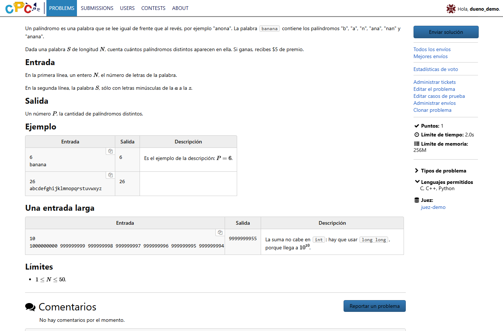

# Sample tables and math in statements

Problem statements, their translations and editorials accept two additions to
DMOJ's Markdown: the sample table that OmegaUp uses, and `$...$` for inline math.
Everything else keeps the original syntax, and statements that use neither render
exactly as before. Contest descriptions, comments, blog posts and profiles do not
get these additions.



## Sample tables

```
## Example

||input
6
banana
||output
6
||description
The example from the statement: $P = 6$.
||input
26
abcdefghijklmnopqrstuvwxyz
||output
26
||end
```

- Each `||input` starts a row. `||output` and `||description` switch to that part
  of the row; `||end` closes the table.
- Input and output are shown exactly as written, HTML included, in monospace.
  The description is Markdown, with math, emphasis, lists and code.
- The description column only appears if some row has one.
- Markers are case-insensitive, may have up to three spaces before them and
  trailing spaces after them, and need no blank line before the table.
- **Without a closing `||end` nothing changes**: the lines stay ordinary text. The
  markers inside fenced code blocks or HTML are left alone too.

The table is only as wide as its samples and each column as wide as its own
content, so a short output does not take the width of a long input. A sample line
too long for the page scrolls inside its cell; descriptions wrap. The copy button
of the problem page becomes an icon in the corner of each input. Printed, inputs
break at spaces and outputs never split a number.

The table brings its own small stylesheet, appended once after the rendered
statement, so it looks the same on the problem page, in duels, on a projector, in
the admin preview and in PDFs, in light and dark themes, without touching the
compressed site stylesheets.

## Inline math with `$...$`

`$...$` works next to DMOJ's `~...~`, and `$$...$$` keeps its meaning as display
math. To keep prices as text, it follows Pandoc's rules:

- the opening `$` must be followed by a non-space;
- the closing `$` must follow a non-space and must not be followed by a digit;
- a formula cannot contain a backtick, so `$` in inline code never opens one.

| Written | Result |
| --- | --- |
| `Let $n$ be the size and $1 \le a_i \le 10^9$.` | two formulas |
| `It costs $5 and $10.` | text |
| `$ x$ and $x $` | text |
| `` `$ ./a.out` `` | code |
| `From \$10 to 20\$.` | text, with literal dollar signs |

One case reads as a formula when it was meant as text: `From $10 to 20$ pesos`
has a valid opening and closing dollar sign. Write `\$` for a literal one.

## Where it applies

The Markdown styles `problem`, `problem-full` and `solution` in
`judge/jinja2/markdown/__init__.py` (`STATEMENT_STYLES`). Editing a statement
refreshes its cached rendering as usual. No migration and no settings.

Tests: [`tests/statements`](../tests/statements/README.md).
